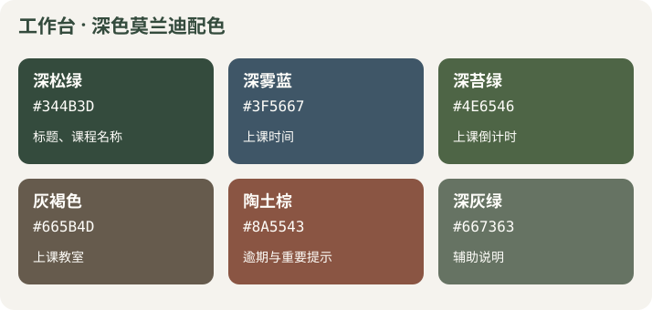

# 工作台配色说明

工作台使用浅莫兰迪背景与深色文字，突出课程名称、上课时间、教室、倒计时和作业截止。样式仅作用于工作台。

| 颜色 | 色值 | 用途 |
|---|---|---|
| 深松绿 | #344B3D | 标题、课程名称 |
| 深雾蓝 | #3F5667 | 上课时间 |
| 深苔绿 | #4E6546 | 上课倒计时 |
| 灰褐色 | #665B4D | 上课教室 |
| 陶土棕 | #8A5543 | 逾期与重要提示 |
| 深灰绿 | #667363 | 辅助说明 |

高优先级使用灰玫瑰色 #77545E，逾期使用陶土棕并显示“已逾期”文字。主要按钮使用 #526B48，底色为 #F5F3EE，卡片保留浅绿、雾蓝和米褐区分。日期、课程和截止时间使用更高的字重，辅助说明保持次要层级。

